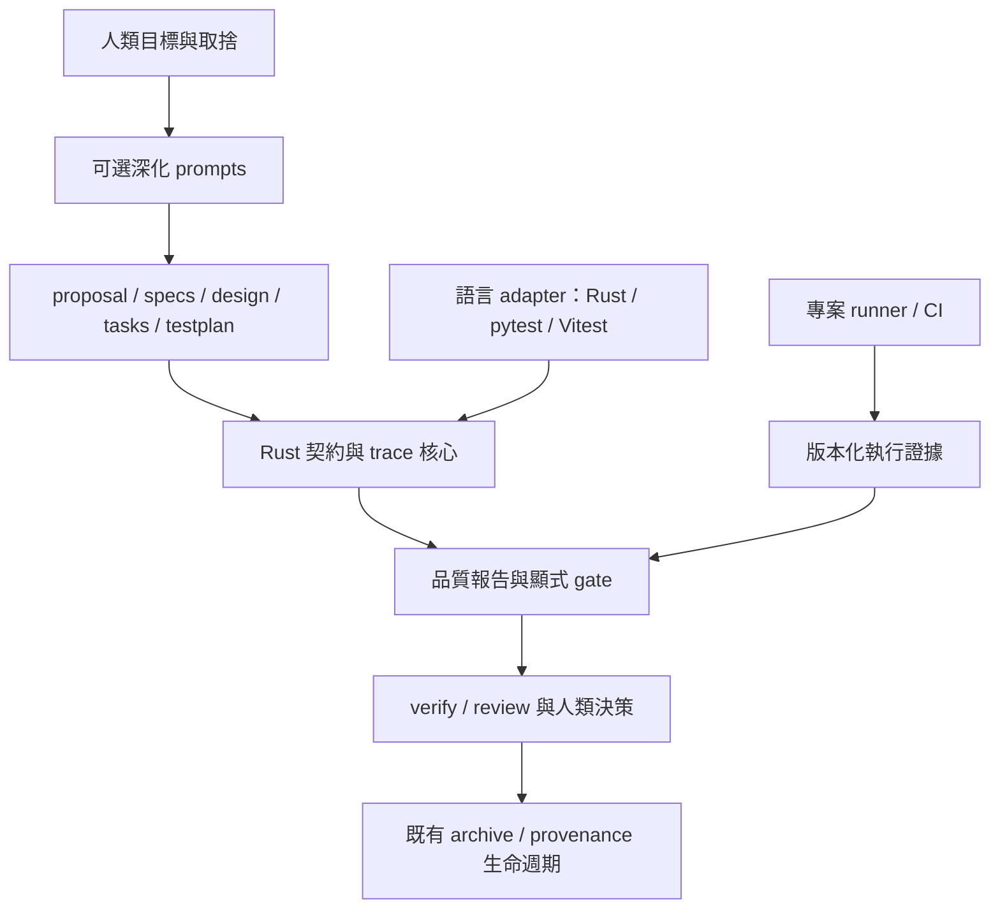
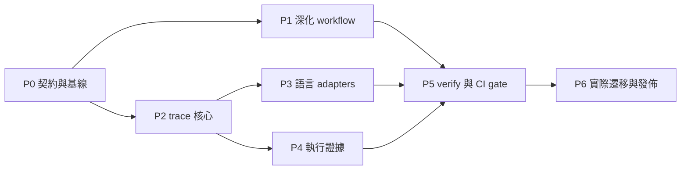

# ADR-0001：OpenSpectra 規格深化、測試追蹤與驗證證據升級計畫

- 日期：2026-11-02
- 狀態：**Proposed — 待維護者核准；不是已實作或已發布功能**
- 決策者：OpenSpectra 維護者（howie）
- 範圍：OpenSpectra、yibi-stack 的 SDD 整合，以及 Matt Pocock／pstack／ub-mode 方法的取捨。
- 本次授權：記錄改善計畫與外部套件使用策略；不包含安裝套件、修改產品程式、發布、跨 repo 寫入或合併 PR。
- 本機研究基準：`24b972753bde17193f25dc10cf1e0ffaa7cdd44a`。
- 關係：延續 [migration-plan](../migration-plan.md) 的 A1–A5；不取代既有相容性裁決，不宣稱現有 migration gates 已通過。

本文的 MUST／SHALL 表示**提案獲准後的實作與驗收要求**，不是現有系統的能力。階段名稱、資料欄位及 extension profile 都是設計提案；沒有列為「現有指令」的功能不得當成已可執行的 CLI 使用。

## 1. 決策摘要

建議採「**相容性核心 + 可選規格深化 + 確定性 trace 檢查 + 可核對的執行證據**」，不把四套 agent orchestrator 疊在一起。

1. OpenSpectra 擁有 change／artifact／task／archive 的主生命週期。
2. spectra-amplifier 的通用能力逐步移入 OpenSpectra：問題與假設框架、QA testplan、testing seams、Scenario／TC 綁定契約；保留 opt-in，不強制每個 change 都寫厚文件。
3. Matt Pocock 提供需求訪談、共享術語、公開測試介面與垂直切片方法；不再另建一份 PRD／tickets 作為競爭的真相來源。
4. pstack 提供 caller-first design、真實操作驗證配方與可重現 review；不接管 OpenSpectra 的任務與合併政策。
5. ub-mode 提供行為保護下的重構、mutation 與品質量測方法；不直接引入固定分數門檻或推送主幹政策。
6. Rust 負責客觀資料關係、狀態與安全操作；prompt 負責語意推理；runner 產生執行證據；CI／人類決定放行。
7. yibi-stack 最終保留 Claude 等工具的安裝、dispatch、Figma／PR 流程等整合；移出的通用方法與 checker 不保留第二份可獨立演進的副本。

最高優先序仍是：**可直接、安全安裝為 oracle spectra 的替代品**。深化能力不能成為既有使用者升級的額外障礙。

## 2. 已知現況與證據邊界

### 2.1 OpenSpectra 的三種責任

| 能力 | 目前的實現 | 不能推論的保證 |
|---|---|---|
| `discuss`／`clarify`／`propose` | Markdown skill 由 agent 執行；Rust 提供 context／template／檔案操作 | agent 已理解需求或已得到人類裁決 |
| schema／`status`／`instructions` | Rust 解析 artifact DAG、檔案存在與 task 狀態，輸出 instructions | artifact `done` 等於內容正確、測試通過 |
| `analyze` | Rust 檢查文件 Coverage／Consistency／Ambiguity／Gaps 等規則 | Coverage 等於程式測試覆蓋；findings 自動造成非零退出 |
| `validate` | Rust 的 OpenSpec 規則與既有明文安全分歧；invalid 時非零退出 | 功能已實作、Scenario assertions 充分 |
| `apply`／`tdd` | prompt 要求 RED／GREEN／Refactor、獨立 expected values 與先驗證再完成 | Rust 監督 code/test 的撰寫先後 |
| `task start`／`task done` | Rust 記錄 baseline、checkbox、檔案歸屬 | `task done` 必須有 passing test 才成功 |
| `verify`／`review`／`audit` | agent 檢查語意；Rust `scope` 提供 diff 與 snapshot 一致性 | agent 報告是由 test runner 產生的執行證據 |
| `archive`／`spec.trace.yaml` | Rust 套用 delta、資料保護、歸檔與 requirement 變更來源紀錄 | archive 成功等於品質驗收；provenance trace 等於 Scenario-to-test trace |
| 開發工具鏈 | Cargo、capture/replay、Python mutation harness、CI | 一般使用者執行 `spectra validate` 會自動跑這些工具 |

程式依據：[`skills.rs`](../../crates/spectra-core/src/skills.rs)、[`main.rs`](../../crates/spectra-cli/src/main.rs)、[`coverage.rs`](../../crates/spectra-core/src/analyze/coverage.rs)、[`change.rs`](../../crates/spectra-core/src/change.rs)、[`verify.md`](../../crates/spectra-core/assets/skills/verify.md)、[archive trace 說明](../reverse-engineering/archive.md)。

目前 `instructions --skill` 只是輸出嵌入文字；`.spectra.yaml` 的 `tdd: true` 由 apply prompt 解讀，不是 `task done` 的 Rust 測試閘門。`analyze` 正常輸出 findings 時 exit 0；`drift` 的嚴重度也不直接映射失敗 exit code。既有 CI 的 `mutate-check.py --check-anchors` 只檢查 anchor，不等於執行全部 mutation cases。

### 2.2 Amplifier 的增量與缺口

| 內容 | 已有價值 | 整合前必須處理 |
|---|---|---|
| R／S／W、四元素萃取、US／AC | 顯式化假設與需求來源 | 論證是人工／agent 推理，不宣稱已由形式化工具證明 |
| QA 六技法、Test Seams、`testplan.md` | 系統化設計測試，先約定公開觀察介面 | 不能把 TC 數量當品質，seam 必須對照真實 codebase |
| `check_spec_coverage.py` | Scenario slug 與 `spec:` 文字對應 | 會把測試檔常數字串算為 covered；不能作為唯一 gate |
| `check_testplan_trace.py` | Python／Vitest AST 綁定，missing／orphan／mismatch／collision | 不執行測試、不讀 assertions 的語意；目前沒有 Rust adapter |
| `trace: enforced` ratchet | 新計畫逐步變嚴，減少舊專案一次性阻塞 | `--strict` 仍受 plan opt-in／Kind 等契約影響，不能解讀為所有問題必定 FAIL |
| Manual Verification | 自動與人工驗證分離 | 勾選只代表宣告；未識別操作者、版本與證據時不能當可信執行結果 |
| plugin orchestration | 現有 Claude 工作流可用 | 特定 agent 名稱、模型、plugin path 與 runtime 相依不能綁進通用 CLI |

較新的 TC checker 支援 pytest 與 Vitest；不可再把整套 amplifier 描述成只有 pytest。舊的 Scenario scanner 仍只掃 `test_*.py`。`--report` 是列舉模式，不能用其 exit 0 宣稱 strict 驗收通過。

### 2.3 本次研究已執行的界線實驗

以下為本對話在暫存目錄使用既有 OpenSpectra release binary、以及 yibi-stack main 的 Python checker 執行結果。未重建 binary、未做 oracle differential probe；暫存檔已移除。它們是設計依據，不代替未來 release 的可重播驗收資產。

| ID | 實驗 | 觀察 |
|---|---|---|
| E01 | 只有合法 delta spec，沒有產品 code／tests，執行 `validate` | exit 0、valid true |
| E02 | 沒有 test runner，直接執行 `task done 1` | exit 0、checkbox 完成；git tracking 不可用另有 warning |
| E03 | requirement 未對應到 task，執行 `analyze` | 有 `covMissingTask` warning，exit 0 |
| E04 | 只在 Python 常數字串放 `spec:`／`tc:` | 舊 scanner 顯示 1/1 covered；新 AST checker strict exit 1 |
| E05 | 真正 test function 有 docstring 綁定，但 body 為 `assert False` | 新 checker strict exit 0；實際執行同一測試 exit 1 |
| E06 | 依 amplifier 的 US／AC／Scenario 與 `[ADDED]` 骨架填內容 | OpenSpectra validate exit 1：No delta sections found |
| E07 | 將同一行為改成 OpenSpec ADDED Requirements／Requirement／Scenario | validate exit 0 |

E06 是對該模板形狀的有限實驗，不表示所有既有 amplifier 產物都不相容。P0 必須把這些界線轉成版本固定、可重播的 fixtures。

## 3. 目標、非目標與不變條件

### 3.1 目標

- G1：維持 [A1–A5](../migration-plan.md) 的既有 CLI／輸出／安裝相容契約。
- G2：只有一套需求、任務與規格來源；需求深化不必二次覆寫 propose 的完整成果。
- G3：以機械檢查證明 Scenario／TC／test references 一致，而不是靠文字 grep 或 agent 自述。
- G4：分開顯示設計覆蓋、靜態綁定、實際執行、結果新鮮度與人工 review。
- G5：Rust、pytest、Vitest 三個首批 adapter 都有真實執行驗收；其他框架明確 unsupported，不假裝零缺漏。
- G6：同一套深化方法能由不同 agent harness 使用；特定 provider／模型不是完成規格的先決條件。
- G7：讓採用者知道現在要裝什麼、何時可移除舊依賴，並能安全回退。

### 3.2 非目標

- 不建立新的通用 issue tracker、PR 自動合併器、model router 或 agent fleet。
- 不把 Figma、Jira、Claude、Node、Python 加成基本 `spectra` CLI 的強制 runtime 相依。
- 不把語意 review、領域假設或需求充分性偽裝成 deterministic proof。
- 不強制每個 change 都產生 problem-frame／testplan；不改變 `no-spec` 的適用範圍。
- 不用固定 AC／Scenario 數量、Story 天數、CRAP 或 duplication 分數決定所有專案是否合格。
- 不擅自變更 oracle 行為、不手改 capture assets／goldens、不把本 ADR 當作新 CLI 介面的批准。

### 3.3 相容性與授權不變條件

1. 未 opt-in 的專案 MUST 保持原本預設指令、輸出、exit codes、artifact layout 與 update 行為。
2. 強化 trace／evidence gate MUST 與 OpenSpec 相容的 `validate` 規則分離；不得偷偷增加新的預設拒絕條件。
3. `task done` 與 `archive` 的預設語意不因新 gate 改變。團隊強制政策先放在顯式 CI check；是否新增 CLI opt-in enforcement 由 P0 裁決。
4. Capture 的 oracle assets 保持原來源及重生流程；OpenSpectra 自有深化 prompts／templates 有獨立來源與測試，不覆蓋偽裝成 oracle capture。
5. 人類擁有產品方向、scope、相容性／安全取捨與合併權。可逆 code 不等於 agent 可以自行裁決被推翻的需求前提。
6. 不同模式不能同時指揮同一任務：OpenSpectra apply 的 TDD 契約為主，不再疊上 Matt／pstack／ub-mode 的完整執行模式。

## 4. 建議架構與責任歸屬



### 4.1 納入 OpenSpectra

| 擬納入能力 | 位置與 owner | 完成條件 |
|---|---|---|
| 問題釐清、假設、caller examples、QA 技法 | 自有可選 skill／template；OpenSpectra 維護 | 無指定模型依賴，能在非 Claude harness 交付同契約 |
| 深化 artifact profile | schema＋必要的建立／載入／instructions 接線 | 不只列在 schema：能建立、續作、驗證、park/unpark、歸檔 |
| Scenario／TC 身分、關聯與 policy | `spectra-core` 純邏輯 | 相同輸入得到相同 findings；路徑／歸檔／改名邊界有測試 |
| testplan／binding／evidence 輸入解析 | 邊界解析後傳 typed data；CLI 維持薄層 | 損壞／不支援／空集合不會被誤報通過 |
| trace／evidence 品質報告 | Rust 核心判定；新擴充介面由 P0 核定 | JSON 與 exit 契約版本化，與既有 analyze／validate 分離 |
| 基礎驗證配方結構 | OpenSpectra 自有 template | Launch／Doctor／Drive／Evidence／Cleanup；實際命令仍由各專案擁有 |

### 4.2 留在外部

- yibi-stack：Claude marketplace 安裝、agent dispatch、Figma 擷取、PR/mob review、Jira 等整合。
- 各語言工具鏈：Cargo、pytest、Vitest、coverage、mutation 與真實 app harness。OpenSpectra 不重寫 test runner。
- Matt／pstack：深入架構探索、研究、特殊 review、形式驗證等按需技能；一般深化方法移入後不需為相同能力重複安裝。
- ub-mode companion tools：可選品質量測，不是基本套件或通用硬 gate。
- 專案 CI：執行環境、秘密資訊、測試指令、required checks 與放行政策。

## 5. 資料與工作流程契約

### 5.1 Artifact 單一來源

- `proposal.md`：問題、範圍、US／AC 與完成條件；不是第二份實作 checklist。
- `specs/<capability-path>/spec.md`：唯一 normative behavior，維持 `ADDED/MODIFIED/REMOVED/RENAMED Requirements`、`Requirement`、`Scenario` 結構。`[ADDED]` 文字不代表 OpenSpec delta。
- `design.md`：caller usage、資料與介面、取捨、Implementation Contract；不重複抄 normative scenarios。
- `tasks.md`：可獨立驗證的垂直切片、既有 `[after: ...]` 依賴語法、驗證目標。Rust 的 task index 與文件編號必須區分，不以 TC-ID 或 `T010` 冒充 CLI task index。
- `problem-frame.md`：有必要才建立；W 為假設的唯一來源，proposal 引用而非重新編寫。R/S/W 論證不是機械形式驗證結果。
- `testplan.md`：TC 定義、seam、資料、預期結果、風險及 manual checks 的唯一來源。Coverage summary／Traceability Matrix 應由同一份關聯衍生；若仍接受舊版重複表格，矛盾時報錯，不採 last-write-wins。
- 執行證據：runner／CI 擁有；不把 stdout／整份測試報告複製到每份 spec。

一般 `spec-driven`／`no-spec` 不變。深化 profile 的名稱建議為 `amplified`，但尚未存在；P0 決定最終命名與啟用介面。不得因 profile 出現在 `schemas` 就宣稱所有 artifact 操作已支援。

### 5.2 Trace identity 與遷移

建議採版本化身分：project namespace、完整 capability 相對路徑、穩定 requirement key、顯式 scenario key；TC 定義具有明確 plan owner；test key 包含 framework／相對檔案／runner 可識別的測試身分。

- 不只使用最後一層 capability 目錄名稱，避免巢狀能力撞名。
- 不以 CJK 顯示名稱或自動 slug 化結果當唯一永久身分。
- 相同 slug 位於不同 requirement／capability 時不得誤連；同一身分重複定義必須報錯。
- requirement／scenario 顯示名稱改變不應默默改變身分；語意改變則使舊執行證據 stale。
- archive 移動 change 位置不應讓既有綁定失效；rename／remove 需顯式遷移或 retirement 記錄。
- 不在 Rust 程式內長期維護兩份「舊／新都猜看看」的解析路徑。舊資料經一次性、可預覽的遷移後切換；未遷移資料顯示 legacy／unsupported。
- 身分持久化的具體格式（extension metadata 或獨立 manifest）屬 P0 的持久化裁決；不得在未核定前大量改寫 canonical specs 或 `spec.trace.yaml`。
- 既有 `spec.trace.yaml` 保持 requirement 變更來源的角色；新測試 trace 不直接覆用或改版該 sidecar。

### 5.3 測試綁定與測試內容

1. 靜態 binding、test collection、execution result 各自記錄，不能只輸出一個 covered 百分比。
2. pytest／Vitest 沿用其 AST 能識別的明確宣告；Rust adapter 要能處理 inline unit tests、integration tests、module path、`cfg`／feature／target 差異。
3. 未能解析的 Rust macro 生成測試不得猜測成一般函式；需可靠 collection 對應或回報 unsupported。
4. 參數化測試、skip／ignore／xfail／todo、零測試 filter、同名測試、重複 TC、動態名稱都要有明確政策。
5. 以 test runner 的實際 collection 確認測試身分；AST 找到函式不等於 runner 會收集或執行。
6. 有 binding 但 assertion 無效、照抄 production 計算、或測錯 seam，仍需語意 review／負向控制／mutation；核心不得宣稱可自動證明 assertion 充分。
7. 在 Rust adapter 可用前，OpenSpectra 自身用既有 Rust 測試與 mutation 證據；不為通過 Python scanner 而新增假的 Python wrapper test。

### 5.4 執行證據與信任

建議 evidence record 至少包含：格式版本、producer／runner 版本、change／Scenario／TC／test references、執行命令與參數、工作目錄、時間、source/spec/test/config fingerprints、target／features、環境識別、collection／執行／skip 數、結果、exit code、log／artifact 位置及 checksum。

- 工作樹可能未提交：只記 HEAD SHA 不足以認定新鮮度。
- 結果區分 passed／failed／not-run／blocked／skipped／unsupported；fresh／stale／unknown 是獨立維度。
- `passed-prior` 只在 relevant identities 可比較且相符時重用；不相符或缺失即未驗證，不能因「上次全綠」沿用。
- TDD 的 RED evidence 必須是 intended behavioral failure，不能把 syntax／setup／compile error 當 RED。GREEN 不足以證明先前真的 RED。
- 過去已有行為的 regression 用 deliberate mutation 證明敏感度，不虛構 failing-before。
- Manual evidence 要記錄確認者、操作、觀察、版本與證據引用；agent 勾 checkbox 不等於人類授權。
- 本地 evidence 檔可被同一使用者修改，不是防惡意竄改的證明。合併 gate 優先採受控 CI 產生、與 PR head 綁定的 artifacts；本地結果明標來源。
- 不把秘密值、個資、token 或完整環境變數寫入證據；記錄允許欄位與必要 fingerprints。敏感 artifacts 留在受控位置。
- testplan／外部 report 是不可信輸入；不得自動執行其中任意 shell 指令。執行只來自明確授權的專案 runner 設定；解析器有路徑、大小與格式邊界。

### 5.5 Gate 與執行政策

建議新增獨立、opt-in 的 quality report／gate 能力；最終命令名稱與 exit codes 於 P0 核定。本文不發明可直接使用的 `spectra verify` 子命令。

- 規劃中：尚未寫測試是 planned／missing，不是假綠，也不阻止保存未完成計畫。
- 宣稱完成：啟用的政策要求所有必要 TC 有 binding、可收集、實際通過且 evidence fresh；必要 manual checks 已有確認。
- 工具不存在、未知框架、解析失敗、零執行數、stale evidence 必須明確不滿足嚴格 gate。
- 正當 exclusion 必須有範圍、理由與決策來源；與 passed 分開，不靠刪 TC 或改 Kind 消除 failure。
- report-only 與 enforcing 的 exit 契約不同且清楚顯示模式；不重現「報表 exit 0 被當 gate」的混淆。
- archive 仍是既有資料操作。CI quality check 與 merge policy 才是預設強化位置；不替人類決定 merge 或 archive 授權。

## 6. 外部套件：是否安裝、何時使用、何時退場

本表是採用策略，不是本機已安裝清單。下列安裝範例來自上游文件，**本次未執行**。自動更新可能改變行為；試點和 release 驗收要記錄實際版本／commit，不只記 marketplace 名稱。

| 套件／工具 | 現階段是否需要 | 使用時機 | 納入後的角色與退場條件 |
|---|---|---|---|
| OpenSpectra CLI | 所有使用 OpenSpectra 流程的專案需要 | artifact／task／validate／archive 全程 | 主系統；基本安裝不新增 Python／Node／模型依賴 |
| yibi-stack `sdd` | **現階段使用完整 amplifier 才需要**；一般 OpenSpectra 不需 | 深化規格、QA agent、現有 trace checkers；先遵守本文的格式修正要求 | P6 通用能力切換後，只有 Figma／Claude-specific 整合等需求才保留；不可提早移除仍依賴的 agent/scripts |
| yibi-stack `methodology` | 現有 amplifier medium/high 的 Problem Frames 步驟需要；其他按需 | Event Storming、R/S/W、QA 深入設計 | 移入 OpenSpectra 的精簡流程不再依賴此 pack；獨立 workshop／深入方法論仍可保留 |
| yibi-stack `dev-cycle` | 非 CLI／amplifier 的基本依賴 | 已有 PR cycle、mob review、verify-done、現有 amplifier-verifier 的團隊 | 留外部；P5/P6 更新呼叫契約，避免重複執行舊 checker |
| Matt Pocock skills | **非必要，選裝** | 尚未收斂的需求、術語、架構或特別的 review／retro | 通用方法納入後不需為 propose/TDD 再裝；想使用其他獨立技能才保留 |
| pstack | **非必要，選裝** | `architect`、`interrogate`、建立／維護真實驗證 skill、特殊狀態模型 | 留作專家工具；OpenSpectra 只吸收方法與產物契約，不預設啟動 `poteto-mode` |
| Cursor `cursor-team-kit` | 只在選用 pstack 的特定 control／deslop 能力時需要 | 上游指出 `control-cli`／`control-ui`／`deslop` 不隨 pstack 附帶 | 依實際 harness 需求安裝，不是 OpenSpectra 必需；沒有工具時明確 blocked／unsupported |
| ub-mode skill | **不建議作為 OpenSpectra 的常駐模式** | 獨立品質工作坊或比較工程規則 | 吸收原則；不採 mainline push、不以其 TDD 模式覆蓋專案契約 |
| crapper／dryer／mutator／uml-viewer | **全部選裝，先量測再考慮 gate** | 高風險模組的複雜度、重複、mutation 或視覺化分析 | 留外部；分數不可代替需求驗收，且不得取代 value-level mutation harness |
| Python 3／pytest | 使用現有 Python checkers 或測 Python 專案時需要 | 過渡期 checker、pytest adapter／runner | Rust 通用 core 不依賴 Python；pytest 專案本來的 runtime 仍需 |
| Node／TypeScript／Vitest | 只對 Vitest adapter／專案需要 | AST 綁定與 Vitest collection／execution | 不綁基本 CLI；目前 SDD package 宣告 Node >=18、TypeScript 5.6.3，未來 adapter 另訂測試版本矩陣 |
| Rust／Cargo 與既有 mutation harness | 開發 OpenSpectra 或驗證 Rust 專案需要 | TDD、build、tests、mutation、release | 保留；不可與會原地改 source 的 mutation harness 並行跑 Cargo |
| Spectra.app oracle 3.0.0／OpenSpec 1.13.2 | **相容性維護與校準環境需要；一般使用者不需** | capture／differential probe、A1–A4 回歸 | 不因本升級移除 oracle；不將校準相依變成使用者 runtime |
| Playwright／PTY／HTTP 等專案 harness | 依產品表面選擇 | 真實 UI／CLI／service smoke | runner 外部能力；先重用專案既有工具 |

### 6.1 已有上游安裝入口

以下只供操作者選用；不應一次全部安裝，也不應讓 setup 自動改寫未授權的專案設定。

**yibi-stack（Claude Code）：**

```sh
claude plugin marketplace add heyu-ai/yibi-stack
claude plugin install sdd@yibi-stack
claude plugin install methodology@yibi-stack
# 只有需要 PR orchestration 時：
claude plugin install dev-cycle@yibi-stack
```

**Matt Pocock（擇一安裝管道，不同時 plugin 與 skills 複製安裝）：**

```sh
# Claude Code
claude plugin install mattpocock-skills@claude-plugins-official
# Codex：另一種 harness 的入口，不是前一指令的必要後續
codex plugin marketplace add mattpocock/skills
codex plugin add mattpocock-skills@mattpocock
```

若實際使用其獨立工作流，依上游執行 `/setup-matt-pocock-skills`，並指定不要另建與 OpenSpectra 競爭的 spec／task 真相來源。其他 agent 可參考上游 `npx skills@latest add mattpocock/skills -a <agent>`；這是可變版本入口，不是可重現版本鎖。

**pstack：** Cursor 內使用 `/add-plugin pstack`；Claude Code 內使用：

```text
/plugin marketplace add cursor/plugins
/plugin install pstack@cursor-plugins
/pstack:setup-pstack
```

setup 可能寫入 harness 規則／模型設定，先確認範圍。只調用選定技能；不照搬上游自動 shipping／merge 或「所有可逆取捨都先做再說」政策。

**ub-mode：** 上游提供把 `SKILL.md` 放進 agent skills 目錄的方式，沒有統一 companion-tool 安裝命令。本計畫不要求安裝；若要試點工具，依各工具 README 固定版本、檢查 runtime 與安裝副作用後，在隔離環境執行。

### 6.2 實際使用節奏

| 開發時點 | 主流程 | 需要外部能力的條件 |
|---|---|---|
| 需求還不清楚 | OpenSpectra discuss | 深入訪談選 Matt；複雜領域選 methodology；不是每次都全跑 |
| 寫規格與設計 | propose＋可選深化；目前使用經格式對齊的 amplifier | 尚未完成 P6 時需 sdd／相應 methodology；架構不確定才選 pstack architect |
| 拆 task 與實作 | OpenSpectra tasks／apply／TDD | 只需目標語言工具鏈；不需三套外部 TDD |
| 驗收 | trace checker＋runner＋verify | 對應語言 adapter、UI/CLI harness；必要時用 pstack 建立驗證配方 |
| Review／品質 | 專案 review／audit 與 CI | 深度對抗選 pstack 或既有 dev-cycle；品質熱點才試 ub companion tools |
| 合併與歸檔 | 人類／required checks＋既有 archive | 使用者原有 PR 整合可保留；不因品質報告自動 merge |

## 7. 分階段交付計畫

所有 phase 目前均為 **未實作／未驗收**。以下 work package 可轉為獨立 issues／PR；本 ADR 不建立或關閉任何 issue。各階段輸出必須可用，不接受只編譯得過的 stub 或接線假測試。



### P0 — 決策、基線與可重播實驗

- Owner：OpenSpectra 維護者；與 yibi-stack 維護者確認切換責任。
- P0.1：核定第 10 節的持久化、擴充介面與分發邊界；建立版本化 contract fixture。
- P0.2：把 E01–E07 轉為可重播 baseline，記錄 binary SHA／來源版本／命令／輸出；不把先前暫存實驗當永久測試資產。
- P0.3：列出目前 A1–A5、goldens、template CLI parsing、已知 divergence 的實際基線；未跑的明記未跑。
- P0.4：指定安全 corpus 副本：至少一個 Rust CLI、一個 pytest、一個 Vitest 專案；清楚記錄資料排除、權限與批准。
- P0.5：檢查來源 LICENSE／NOTICE、可再分發的模板與改寫 attribution；在新來源目錄記錄 upstream commit，不手改 oracle captures。
- Exit：契約選項有裁決、fixtures 可重播、corpus 可取得；缺真實 corpus 時阻擋 P6，而不是用 synthetic matrix 宣稱完成遷移。

### P1 — 單一深化 workflow 與格式相容

- P1.1：建立可選深化 profile；需求風險決定 framing／testplan 深度，不以最低文件數量當門檻。
- P1.2：將 amplifier 的 US／AC 放回 proposal，normative behavior 用 OpenSpec Requirement／Scenario；保留顯式 slug 與具體 Example。
- P1.3：導入 QA testplan、caller examples、seams 一次確認；已確認且未改變的 seam 不反覆詢問。新增／改變 seam 必須重新呈現取捨。
- P1.4：task 採可驗證的行為切片與明確依賴；不把 RED tests 全部寫完才開始全部實作。
- P1.5：打通自訂 artifact 的建立、status、instructions、apply context、park/unpark 與 archive 保留；不能只新增 schema JSON。
- P1.6：自有 skills 與 oracle capture 分開分發；任何更新先 preview，不能覆蓋專案自訂內容。非 Claude harness 的單 agent 路徑必須可完成相同產物，無特定子代理不應自動判定規格品質不足。
- Exit：實跑「新 change → 深化文件 → analyze／validate → park/unpark → apply instructions → archive」，在 sandbox 保留額外 artifacts；一般模式輸出維持 baseline。

### P2 — 語言中立 trace 核心

- P2.1：實作第 5 節的 typed identities／TC／seam／binding 資料模型及版本化解析。
- P2.2：實作 missing／orphan／mismatch／collision／invalid-seam／unparsable 檢查，明確處理全量與單 change 選取的 ownership。
- P2.3：支援 active／archived 的關聯生命週期、完整 capability path、rename／remove，以及舊資料的顯式遷移規則。
- P2.4：輸出 deterministic report；保留 findings 的資料依據。語意 Coverage Analysis 仍由 QA/reviewer 判斷，不改名成 Rust 已證明。
- Exit：同名 slug 不誤連、重複定義不覆蓋、缺檔／壞格式不假綠、report 與 gate 模式可區分；不得只驗序列化欄位拷貝。

### P3 — Rust、pytest、Vitest adapter

- P3.1：Rust 靜態 binding 與 Cargo collection 對應；驗 inline/integration tests、features、cfg、ignore、未知 macro。
- P3.2：pytest AST 綁定與實際 collection 對應；驗 class、async、parametrize、skip/xfail、fixture 字串誤命中。
- P3.3：Vitest AST 綁定與 collection 對應；驗 callback 註解、動態／參數化名稱、skip/todo、工具缺失。
- P3.4：每個 adapter 宣告支援版本／能力；未支援語言或 syntax 回 unsupported，不吞成空 binding。
- Exit：三個真實小專案都能分辨「純字串」「可收集測試」「被跳過」「測試實際失敗」；不依賴安裝另一語言的 runtime 才能跑本語言路徑。

### P4 — 執行證據與可重跑驗證配方

- P4.1：定義並實作 evidence import／validation；producer 是 runner／CI，不以 agent 自填 passed 作為可信來源。
- P4.2：接三種首批 runner 的執行結果，偵測零測試、失敗、timeout、setup error、skip，保留 raw logs 的引用。
- P4.3：source／spec／tests／config／環境 identities 驗新鮮度；修改後的 evidence 不能繼續標 fresh。
- P4.4：採 pstack Launch／Doctor／Drive／Evidence／Cleanup 配方；各試點完成至少一條真實使用路徑，觀察輸出與副作用，清理後證據仍存在。
- P4.5：RED／GREEN、mutation、manual evidence 各有來源與限制；不把 compile failure 視為成功殺死行為 mutant。
- Exit：E05 類「bound 但 failing」在綁定報告保持 bound，但 execution gate 明確失敗；stale 與未執行也不能通過。

### P5 — Verify 報告、CI 政策與 agent 品質評估

- P5.1：verify 統一呈現 planned／bound／collected／executed／passed 與 freshness；agent 的語意判斷另欄，不能覆蓋 runner failure。
- P5.2：顯式 quality gate 接入試點 CI；核對 PR head 與 artifacts，required checks 由維護者配置，不假設 workflow 存在等於合併被保護。
- P5.3：更新 apply/review handoff，使 task 完成前用相同 scope 證據；保留既有 CLI 預設完成語意。
- P5.4：新增 skill 行為評估：固定 prompt 集、來源與模型設定；測 scope 遵守、artifact 合法、遺漏率、重複工作、未授權寫入、錯誤宣稱 passing。數值基線由試點量測，不在此捏造效益百分比。
- P5.5：ub companion tools 只做選定模組 advisory 試點；記錄誤報、耗時、能否抓到既有真 bug，再由維護者決定是否採 gate。
- Exit：不靠 agent 自述即可讓 CI 拒絕缺必要證據；同時 agent 不得把通過綁定視為通過需求。無 opt-in 專案不受影響。

### P6 — 真實專案遷移、單一 owner 切換與發佈

- P6.1：在 corpus 副本跑完整規劃、實作、驗收、歸檔、再次修改流程；涵蓋既有 amplifier 文件、舊 TC-ID、nested capabilities 與無 testplan change。
- P6.2：遷移先 dry-run／報告／批准，再套用；保留原始文件與 checksum、變更計畫及驗證結果。重跑不重複 ID、綁定或 history。
- P6.3：yibi-stack 改成呼叫已發布且可偵測能力的 OpenSpectra；同批遷移所有受影響 callers、移除已取代的通用 checker／template 副本。Figma／PR／harness 特有部分保留。
- P6.4：若必要能力不存在，清楚報版本／能力不足，不默默退回舊 scanner 或同時跑兩套 gate。
- P6.5：更新安裝／解除安裝矩陣、CHANGELOG、使用文件與 migration 指南；建立 release candidate，在 macOS／Linux fresh install 驗證。
- P6.6：維護者確認 A1–A5、所有 AC、套件切換與 rollback 演練後才決定 release／tag。合併 PR 不等於已發布。
- Exit：真實專案可在不裝完整四套 skills 的情況完成深化流程；移除舊能力後仍可用；回退保留使用者資料與現有 oracle 相容面。

## 8. 驗收矩陣

所有項目目前均為**待實作驗收**；E01–E07 只提供既有界線證據。

| AC | GIVEN / WHEN / THEN | 驗證方式 | Owner phase |
|---|---|---|---|
| AC-01 | GIVEN 未 opt-in 專案；WHEN 升級並執行既有指令；THEN 預設行為、輸出與已核定 divergences 不變 | A1–A5、golden replay、template invocation parsing、真實 corpus | P0/P6 |
| AC-02 | GIVEN 任意合法 `spec_dir`；WHEN 深化規格；THEN 所有產物在該 root，specs 是合法 OpenSpec delta | CLI sandbox，包含空白／巢狀路徑與兩種既有佈局 | P1 |
| AC-03 | GIVEN 小型 no-spec 與複雜狀態變更；WHEN 選用對應模式；THEN 前者不被強迫造 spec，後者產生需要的 framing/testplan | profile smoke＋agent 行為評估 | P1/P5 |
| AC-04 | GIVEN 只有 fixture 字串宣告 TC；WHEN trace gate；THEN 不計為測試綁定 | E04 負向控制及三語言 adapter fixture | P2/P3 |
| AC-05 | GIVEN bound 但必定失敗的測試；WHEN 執行驗收；THEN bound 與 failed 同時正確呈現，gate 拒絕 | E05 的三語言 runner smoke | P3/P4/P5 |
| AC-06 | GIVEN 舊 passing evidence；WHEN 改動 relevant spec/code/test/config；THEN evidence stale，不能再宣稱 current pass | fingerprint mutation 與 dirty-tree smoke | P4 |
| AC-07 | GIVEN 同名 slug／巢狀 cap／重複 TC／未知 reference；WHEN 檢查；THEN 不誤連、不覆蓋，能指出精確衝突 | typed core regression＋CLI fixture | P2 |
| AC-08 | GIVEN 不支援框架、工具缺失、壞解析、零測試或全部 skip；WHEN strict policy；THEN 明確不滿足，非空報表假綠 | adapter/runner 負向矩陣 | P3/P4/P5 |
| AC-09 | GIVEN active change；WHEN archive 後改名／移除 scenario；THEN provenance 保留、binding 可遷移或明確失效，不誤用舊證據 | 一個 sandbox 一次操作，逐步檢查檔案與 trace | P2/P6 |
| AC-10 | GIVEN 有未確認的必要 manual check；WHEN 宣稱完成；THEN 不以 agent checkbox 取代人類確認 | manual evidence 契約與 review | P4/P5 |
| AC-11 | GIVEN 非 Claude harness 或無指定 subagent；WHEN 深化；THEN 可依相同輸入輸出契約完成，或精確報缺少的真正能力 | 至少 Claude 與另一 harness 的實跑 | P1/P5 |
| AC-12 | GIVEN 一次已完成遷移；WHEN 重跑或回退；THEN 不重複、不丟資料、不誤刪仍使用中的 plugin 功能 | migration dry-run／apply／rerun／rollback | P6 |
| AC-13 | GIVEN 無 Python/Node 的基本使用環境；WHEN 執行原本 CLI 與 Rust-only 品質路徑；THEN 不因外語 adapter 相依而失敗 | macOS／Linux 隔離安裝 smoke | P3/P6 |
| AC-14 | GIVEN 新 prompt 或新模板；WHEN 同一需求交不同 agent；THEN artifacts 遵守相同格式／授權／證據邊界 | 版本固定的 prompt evaluation，差異交人審查 | P1/P5 |
| AC-15 | GIVEN PR head 更新；WHEN CI quality gate；THEN 舊 head 的 passing artifact 不可放行新 head | CI integration sandbox | P5/P6 |

### 8.1 每個產品 PR 的工程驗證

- 依現有專案規範先 probe oracle／OpenSpec 相容面；新自有 extension 則依已核定 contract 建負向與行為測試。
- Rust 改動跑 mutation anchors、fmt、clippy、release build、完整 tests；bug fix 的 named regression 必須能殺死對應 value-level mutant。
- mutation 原地修改 source 時不得與 Cargo／其他編輯並行；probe 前確認 binary 不是殘留 mutant。
- 實際執行 changed CLI／runner 路徑，不能只以 unit tests 或編譯成功宣稱完成。
- 文件／ADR-only PR 做連結、範例、命名及狀態一致性檢查，不將文件檢查記為產品 smoke 或新的 A1–A5 通過。

## 9. 遷移、回退與維護

### 9.1 遷移原則

- 舊專案不自動 opt-in；舊 spec 不為增加 trace 強制重寫所有 headings。
- 舊 testplan 的 `trace: enforced`、Kind、Manual Verification 與 report-only 模式逐項辨識；遷移報告指出哪些保證變嚴／變弱。
- mapping 無法唯一決定時報告歧義並由人裁決；不依目錄 basename、相似字串或碰巧相同 TC-ID 猜測。
- scenario／testplan／evidence schema 各有版本；未知版本 fail clearly。不要把未來格式讀成空資料。
- 不直接破壞既有 canonical spec 或 sidecar；寫入採用已核定的安全資料操作。若需要新的持久化／原子性策略，先依 P0 裁決。

### 9.2 回退方式

- 關閉新 profile／CI gate 只停止強化檢查，不刪 testplan、evidence 或歷史。
- 恢復已釘選的上一版 CLI／plugin 以及備份的專案設定；不讓舊 reader 猜讀新格式。
- 實際產生的 OpenSpec delta/canonical spec 必須仍由既有工具讀取；若某個擴充 metadata 不被舊版本理解，留在隔離命名空間。
- 必須測兩種回退：尚未 archive 與已 archive。已完成的 archive 不由 caller 擅自逆向搬檔；需要恢復時依備份／Git 與已確認計畫操作。

### 9.3 長期維護

- OpenSpectra 擁有移入的通用契約、templates、checkers 與 conformance fixtures；yibi-stack 擁有 harness adapters。
- 外部原則更新只產出差異評估，不能自動覆蓋既有已接受政策；固定來源版本並保留授權聲明。
- 新 adapter 必須帶支援矩陣、collection／execution 負向案例與真實 smoke，不能只宣告支援副檔名。
- 定期記錄 false positives、漏報、人工覆寫、執行成本與需求缺漏；先量測再訂門檻，不以文件數或 TC 數衡量成功。
- 相同問題優先轉成型別、parser invariant、lint、test 或 CI；需要判斷的規則留在 review，不無限制增加常駐 prompt。

## 10. 替代方案、風險與待裁決事項

### 10.1 替代方案

| 方案 | 優點 | 不採為主方案的原因 |
|---|---|---|
| 全留 yibi-stack，只改 prompt | 最少改動、熟悉既有工具 | OpenSpectra 使用者仍依賴特定 plugin，trace／evidence 缺乏共同核心 |
| 整份 amplifier 直接搬入預設 workflow | 表面上整合最快 | 格式／task 語法衝突，綁 Claude/Python/Node，簡單工作被迫變重 |
| 所有判斷都寫成 Rust gate | deterministic、容易接 CI | 需求充分性與 assertion 語意不能靠結構判定；產生錯誤保證 |
| 同時安裝四套完整 orchestrator | 可立即取得所有功能 | TDD、確認、重構與 merge 政策衝突，文件與 checklist 多個 owner |
| 本案：opt-in 深化＋通用核心＋外部 adapters | 保留相容性與選擇權、機械保證清楚 | 需維護版本化契約、adapter 與分發邊界，前期整合成本較高 |

### 10.2 主要風險與控制

| 風險 | 控制與失敗處理 |
|---|---|
| oracle capture 與自有 skill 混淆 | 分開來源／命名／測試；禁止手改生成 assets |
| 綁定數字造成完成假象 | bound／executed／passed／fresh 分開；保留 E05 負向控制 |
| 文件膨脹、測試為湊數而寫 | 依風險選深度；取消硬性 Scenario/AC 數量門檻；review 看行為價值 |
| Rust parser／test runner 對 macro、cfg 理解不同 | collection 對照，未支援明報；不宣稱 AST 等於 execution |
| 新 gate 被繞過 | 清楚描述 enforcement 位置；CI required checks 由維護者驗證，不能承諾 CLI 外所有路徑都不可繞過 |
| 本地 evidence 可偽造或過期 | 記來源與 scope；merge 依受控 CI/head 證據，hash 不冒充信任根 |
| 語言 runtime 與套件供應鏈膨脹 | adapter 按需啟用，固定版本、授權與依賴審查，缺工具 fail clearly |
| 跨 repo 更新失配 | P6 同批遷移 caller、版本／能力檢查；不靜默 fallback、不長期雙維護 |
| 品質指標逼出過度抽象 | CRAP／duplication 先 advisory；人類確認可維護性，不以分數直接推翻設計 |

### 10.3 P0 必須裁決的架構選項

下列均未被本次文件撰寫自動批准。每項給出推薦方向，避免實作時由 agent 默默決定；其餘可依已接受契約自行推進。

| 決策 | 推薦方向 | 替代與代價 | 阻擋範圍 |
|---|---|---|---|
| D1：新能力啟用與 CLI surface | opt-in profile＋獨立 quality report/gate，不改預設 validate/task/archive | 在舊指令加強制 gate 會改相容語意 | P1/P2 公開介面 |
| D2：stable identity 持久化 | 獨立版本化 extension metadata，完整路徑與穩定 key；既有 trace sidecar 不變 | 直接改 spec headings 簡單但會影響 legacy/rename；延伸既有 sidecar 耦合不同責任 | P2 持久化與 migration |
| D3：語言解析與依賴 | Rust core 無外部 runtime；各語言 adapter 按需使用 AST/runner，先審查 Rust AST dependency | 全部 native Rust 增加多語 parser 維護；全部外包 scripts 增加 runtime 安裝 | P3 adapter 選型 |
| D4：證據格式與信任 | 版本化 runner records＋受控 CI artifacts；本地證據只作相應信任級別 | 通用簽章／遠端服務增加部署成本，不是首批必要條件 | P4/P5 gate |
| D5：深化方法分發 | OpenSpectra 自有來源／opt-in 分發，yibi-stack 保留薄整合 | 全留 plugin 減少 CLI 工作，但不完成通用能力上移 | P1/P6 ownership |
| D6：嚴格政策 | 新計畫顯式 opt-in，report 與 gate 分開；先在試點 CI 收緊 | 一次套用全部舊專案會被資料品質債阻塞 | P5/P6 rollout |
| D7：擴充與相容性工作的排程 | 先固定 A1–A5 基線，不讓深化工作阻塞安全替換；各獨立切片另開 PR | 一次大改難以定位相容性回歸 | P0 排程與 release |

## 11. 來源與版本

遠端 repo SHA 於 2026-11-02 查詢；來源內容為研究依據，不是承諾未來 marketplace 仍提供相同版本。實作開始前只重新確認有變動的契約，不以追最新取代可重現性。

| 來源 | 固定版本 | 主要用途 |
|---|---|---|
| OpenSpectra 本機 | `24b972753bde17193f25dc10cf1e0ffaa7cdd44a` | 現行 CLI、skills、CI、相容性與 trace 邊界 |
| [yibi-stack SDD](https://github.com/heyu-ai/yibi-stack/tree/f50b67cda3b926e2489f3525834c1c0a5c37b06d/plugins/sdd) | `f50b67cda3b926e2489f3525834c1c0a5c37b06d`；package 宣告 1.23.23 | amplifier、QA agents、testplan、Python/Vitest checker |
| [Matt Pocock skills](https://github.com/mattpocock/skills/tree/4ae2317ddb22b046e26455e4f9c9b3aaaf62212d) | `4ae2317ddb22b046e26455e4f9c9b3aaaf62212d` | grill-with-docs、to-spec、to-tickets、TDD、review、retro |
| [pstack](https://github.com/cursor/plugins/tree/ae5650febf4320793844c12c4adaa937f417f8da/pstack) | `ae5650febf4320793844c12c4adaa937f417f8da` | architect、interrogate、verification skills、principles、安裝與 harness 限制 |
| [ub-mode](https://github.com/unclebob/ub-mode/tree/57a8bdd28e45ed41900ace0bafa2ff76dd9ed70f) | `57a8bdd28e45ed41900ace0bafa2ff76dd9ed70f` | Make it Work／Right、品質工具與不採用的 push 政策 |

補充原始依據：

- [Amplifier SKILL](https://github.com/heyu-ai/yibi-stack/blob/f50b67cda3b926e2489f3525834c1c0a5c37b06d/plugins/sdd/skills/spectra-amplifier/SKILL.md)
- [TC trace checker](https://github.com/heyu-ai/yibi-stack/blob/f50b67cda3b926e2489f3525834c1c0a5c37b06d/plugins/sdd/scripts/check_testplan_trace.py)
- [Scenario coverage scanner](https://github.com/heyu-ai/yibi-stack/blob/f50b67cda3b926e2489f3525834c1c0a5c37b06d/plugins/sdd/scripts/check_spec_coverage.py)
- [Testplan template](https://github.com/heyu-ai/yibi-stack/blob/f50b67cda3b926e2489f3525834c1c0a5c37b06d/plugins/sdd/references/testplan-template.md)
- [Delta template](https://github.com/heyu-ai/yibi-stack/blob/f50b67cda3b926e2489f3525834c1c0a5c37b06d/plugins/sdd/references/spec-delta-template.md)
- [Matt TDD](https://github.com/mattpocock/skills/blob/4ae2317ddb22b046e26455e4f9c9b3aaaf62212d/skills/engineering/tdd/SKILL.md)：red-green；重構移至 review，與現有 OpenSpectra TDD 契約不同。
- [pstack verification recipe](https://github.com/cursor/plugins/blob/ae5650febf4320793844c12c4adaa937f417f8da/pstack/skills/create-verification-skill/SKILL.md)
- [pstack 安裝與額外能力](https://github.com/cursor/plugins/blob/ae5650febf4320793844c12c4adaa937f417f8da/pstack/README.md)
- [ub-mode SKILL](https://github.com/unclebob/ub-mode/blob/57a8bdd28e45ed41900ace0bafa2ff76dd9ed70f/SKILL.md)
- [Crapper](https://github.com/unclebob/crapper)、[Dryer](https://github.com/unclebob/dryer)、[Mutator](https://github.com/unclebob/mutator)、[UML Viewer](https://github.com/unclebob/uml-viewer)：本 ADR 未安裝／驗收，實際採用前另釘版本。研究所讀 Mutator README 將不編譯的 mutant 算 killed；本 repo 的 value-level harness 明確不接受此種成功。
- [OpenSpectra 回歸對照表](../testing/regression-catalog.md)、[CI](../../.github/workflows/ci.yml)、[artifact workflow](../reverse-engineering/artifact-workflow.md)。

## 12. 本 ADR 完成與產品完成的區分

本 ADR 的完成條件：計畫、責任邊界、套件時機、驗收、遷移回退、來源與未決事項均已記錄，文件可讀且連結可解析。產品完成條件則是 P0–P6 與 AC-01–AC-15 有對應實際證據，維護者批准切換／發佈。

**寫完本文件不會使任何 phase 自動完成，不會改變 ADR 狀態為 Accepted，也不會授權安裝、實作、跨 repo 修改或發布。**
