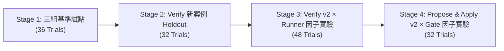

# OpenSpectra Agent Skills 實證評測研究報告（2026-11）

- **日期**：2026-11-03
- **狀態**：已完成（共 4 階段、148 次隔離環境配對與因子試驗）
- **受測基準**：OpenSpectra `24b972753bde17193f25dc10cf1e0ffaa7cdd44a`（`spectra 0.14.1`，Release Binary SHA-256: `14668f93bb881b17416b7b68d5c4415bbb2756528d0caea6c8853e7a7460b2a5`）
- **受測模型與 Harness**：`claude-sonnet-4-6`（Claude Code `2.1.316`，`effort: medium`）
- **關聯決策文件**：[ADR-0001：OpenSpectra 規格深化、測試追蹤與驗證證據升級計畫](../adr/0001-openspectra-quality-workflow-upgrade.md)

---

## 1. 執行摘要（Executive Summary）

本研究針對「Agent Skills 數量與複雜度是否會導致表現退步或偏差」以及「OpenSpectra 內嵌之 `propose`、`apply`、`verify` 三大工作流 Skill 是否應替換為精簡/強化候選版」進行了文獻查證與 **148 次真實隔離環境試驗**。

### 最終工程裁決

1. **全面維持現行內嵌 Skills，不替換產品資產**：
   - `crates/spectra-core/assets/skills/` 下的 `propose.md`、`apply.md`、`verify.md` 維持原狀。
2. **將品質與安全防線移交「執行環境與機械檢查工具」，而非加長 Prompt**：
   - **Verify 工作流**：因子實驗證明，越權寫入（如將暫存檔寫入 `/tmp`）無法靠 Prompt 叮嚀根除；但透過執行環境限制（`sandbox-exec` 寫入防護 + `TMPDIR=.scratch/tmp` + `verify-capture` 收據工具），**現行版 Skill 即能達到 12/12 (100%) 通過、0 違規，且比候選 v2 節省 18.6% Input Tokens**。
   - **Propose 工作流**：在 Prompt 中塞入過多防禦性規則（候選 v2）會誘發模型反覆自我懷疑與重試，導致 **25% (2/8) 試驗觸發 600 秒超時（Overthinking Timeout）**；反觀以輕量 Python 檢查器（`propose-check`）在事後驗證 `.openspec.yaml` 元資料與 CLI 參數語法，能以零 Token 成本達成 100% 攔截。
   - **Apply 工作流**：現行版與候選版在邊界修復與前提衝突案例上表現一致（100% 通過）；TDD 紅綠循環（RED → GREEN）與交接指令正確性應由 transcript 檢查器（`apply-check`）把關，無須改動內嵌 Prompt。

---

## 2. 外部文獻與理論依據

針對「模型掛載過多或過長 Skill 反而降低效益」的現象，2026 年最新實證研究與官方指南給出了明確的機制拆解：

| 研究 / 指南來源 | 實驗規模與方法 | 核心量化發現 | 對本專案的啟示 |
|---|---|---|---|
| **More Skills, Worse Agents?** [arXiv:2605.24050v2](https://arxiv.org/abs/2605.24050) (2026-06) | Claude Haiku 4.5 & Sonnet 4.6；38 組有效任務，2,545 條軌跡；控制技能庫規模 $\|\mathcal{S}\| \in \{\mathcal{S}^\star, 52, 102, 202\}$ | 當技能庫從已知有用的 Oracle 集合擴增至 202 個時，平均通過率**下降 21 個百分點 (pp)**（Haiku 跌 26 pp，Sonnet 跌 15 pp）。因果分解顯示 **Skill Shadowing（語義重疊導致挑錯或放棄載入）佔跌幅的 66.7%**。 | 不能同時安裝多套職責重疊的流程 Skills（如同時掛載三套 TDD / Spec 技能）。 |
| **Lost in Implicit Routing** [arXiv:2610.18522](https://arxiv.org/abs/2610.18522) (2026-10) | 固定 82 個 SkillsBench 任務與 Golden Skills，逐步加入 $0 \sim 10,000$ 個無關干擾 Skills（超過 15,000 條軌跡） | 加入 1,000 個無關 Skills 時，隱式路由的載入召回率從 **73.6% 崩跌至 27.4%**，完全不載入任何 Skill 的比率（Zero-load rate）從 **9.3% 飆升至 51.6%**（Claude Opus 4.6 子集召回率亦從 81.3% 跌至 30.9%）。 | 只看最終任務是否成功會掩蓋路由失效；需分離「技能選用（L1）」與「執行內容（L2）」評測。 |
| **SWE-Skills-Bench** [arXiv:2603.15401v2](https://arxiv.org/abs/2603.15401) (2026-10) | 98 個公開 SWE Skills × 10 個需求，在固定 Git commit 下執行 3,920 組有/無 Skill 配對評測 | 平均通過率僅從 **76.59% 微升至 76.93% (+0.34 pp)**；**92/98 (93.9%) 無統計顯著效果**。退步達 50 分以上的案例中，**33% 源於 Template Anchoring**（Skill 範本寫死路徑覆蓋了專案真實路徑）。 | Skill 內禁止寫死特定目錄（如硬寫 `openspec/` 忽略 `spec_dir`），且每個修改都必須做配對實驗。 |
| **Evaluating AGENTS.md** [arXiv:2602.11988v3](https://arxiv.org/abs/2602.11988) (2026-09) | SWE-bench Lite (300 題) + CTXbench (138 題)，比較無檔案、LLM 生成與開發者編寫之常駐規則 | 常駐規則並未縮短尋找檔案的步數，反而使推論步驟與 Token 成本**增加 20%～23%**，而問題解決率無顯著提升。 | 機械性檢查應移入 CLI / CI，禁止將所有歷史教訓不斷塞回常駐 Prompt。 |
| **Claude Code 官方規範** [Skills Docs](https://code.claude.com/docs/en/skills) & [Evals Guide](https://www.anthropic.com/research/demystifying-evals-for-ai-agents) | 1% 動態 Context 清單預算、25,000 tokens Compaction 上限、配對雙臂評測 | 清單超過 1% Context Window 時，Claude Code 會優先截斷少用 Skill 的 `description` 導致靜默漏觸發；Compaction 後僅保留最近調用 Skill 的前 5,000 tokens。 | 駐留指令必須精簡，重要契約應置於檔案頂部或由確定性工具強制執行。 |

---

## 3. 四階段實驗總覽（148 Trials）

為確保評測客觀性，所有實驗均在獨立 Git 沙盒中執行，停用外部自動載入之 Skills 與 MCP，結合**確定性編譯/腳本檢查（Mechanical Grader）**與**隱藏組別標籤之獨立審查（Label-Blinded Semantic Review）**：

| 階段 | 實驗目的 | 受測工作流 | 比較組別 / 因子設計 | 案例數 × 重複 | 總試驗數 | 原始證據目錄 |
|---|---|---|---|---|---:|---|
| **Stage 1** | 探測無 Skill、現行版與精簡候選版 v1 的邊際差異 | `propose` `apply` `verify` | 3 Arms：`none` vs `current` vs `candidate_v1` | 6 cases × 3 arms × 2 reps | **36** | `tmp/skill-eval-2026-11-02/` |
| **Stage 2** | 以未參與調參之全新案例驗證 `verify` 候選 v1 是否達替換門檻 | `verify` | 2 Arms：`current` vs `candidate_v1`（原封不動） | 8 new cases × 2 arms × 2 reps | **32** | `tmp/verify-holdout-2026-11-02/` |
| **Stage 3** | 分離「Prompt 規則」與「環境寫入限制（Runner Guard）」的效果 | `verify` | 2×2 Factorial：(`current`, `candidate_v2`) × (`legacy`, `guarded`) | 6 new cases × 4 cells × 2 reps | **48** | `tmp/verify-factorial-v2-2026-11-02/` |
| **Stage 4** | 分離 `propose`/`apply` 候選 v2 與機械檢查工具的效果 | `propose` `apply` | 2×2 Factorial：(`current`, `candidate_v2`) × (`no_gate`, `mechanical_gate`) | 4 new cases × 4 cells × 2 reps | **32** | `tmp/propose-apply-v2-2026-11-02/` |

---

## 4. 各階段實驗結果與關鍵發現

### 4.1 Stage 1：三組配對基準試點（36 Trials）

在 6 個合成 Rust 微型專案案例（`P-feature`、`P-nospec`、`A-boundary`、`A-premise`、`V-defect`、`V-clean`）上，比較無可選 Skill、現行版與精簡候選版 v1（字元數縮減 66%～78%）：

| Workflow | 組別 | 最終通過／執行 | 平均耗時 (秒) | 平均 Tool Calls | 平均處理 Input Tokens (含快取) | 平均 Output Tokens | 組別 List-Price 估值 (USD) |
|---|---|---|---:|---:|---:|---:|---:|
| **propose** | 無 skill (`none`) | 2/4 | 83.8s | 28.25 | 402,875 | 4,987 | $1.0705 |
| **propose** | 現行版 (`current`) | 3/4 | 94.5s | 23.00 | 398,117 | 5,615 | $1.1038 |
| **propose** | 候選版 v1 (`candidate`) | 3/4 | 81.1s | 24.25 | 368,304 | 4,984 | $1.0364 |
| **apply** | 無 skill (`none`) | 4/4 | 33.4s | 11.25 | 115,570 | 2,088 | $0.4175 |
| **apply** | 現行版 (`current`) | 4/4 | 51.8s | 20.50 | 261,120 | 3,440 | $0.7239 |
| **apply** | 候選版 v1 (`candidate`) | 4/4 | 44.3s | 18.00 | 212,977 | 2,903 | $0.5970 |
| **verify** | 無 skill (`none`) | **1/4** | 32.5s | 8.50 | 99,089 | 1,954 | $0.3944 |
| **verify** | 現行版 (`current`) | **4/4** | 67.2s | 21.00 | 200,456 | 4,188 | $0.6836 |
| **verify** | 候選版 v1 (`candidate`) | **4/4** | 49.5s | 17.00 | 155,605 | 3,129 | $0.5473 |

#### Stage 1 關鍵診斷

1. **`verify` 的 Skill 價值最顯著**：
   - 無 Skill 組在 2 次 `V-clean` 中僅跑了单元测试，未執行規格要求的公開 CLI 驗證就宣告可交付；在 `V-defect` 中雖從原始碼看出 `total > 100` 的邊界錯誤，但竟將業務函式複製到 `/tmp/verify_boundary.rs` 獨立編譯執行，而非測試真實產品入口。
   - 現行版與候選版 v1 均 4/4 通過，且候選版 v1 耗時降低 **26.4%**、Input Tokens 降低 **22.4%**，因此被選入 Stage 2 進行嚴格 Holdout 驗證。
2. **`propose` 的兩類典型缺陷**：
   - **無效的 CLI 驗收指令**：無 Skill（2 次）與現行版（1 次）在 `tasks.md` 或 `spec.md` 寫出 `./eval_app -- -1` 或 `cargo run -- -- -1`。因受測專案 `src/main.rs` 直接以 `std::env::args().nth(1)` 解析整數，傳入 `--` 會觸發 `ParseIntError`（exit 101）而非預期的負數錯誤（exit 2）。這證明 `spectra validate` 僅能檢查 Markdown 結構，無法驗證指令語意。
   - **元資料覆寫退步**：候選版 v1 在 `trial-19`（`P-nospec`）中直接以 `skip_specs: true` 覆寫 `.openspec.yaml`，導致原有的 `schema: no-spec` 遺失。
3. **`apply` 的 TDD 假象與交接指令幻覺**：
   - 雖然 6 次 `A-boundary` 實作皆通過事後隱藏測試（涵蓋 `-1, 0, 99, 100, 101, i64::MAX`），但檢視軌跡發現**只有現行版的 `trial-13` (1/6) 真正先跑出失敗的紅燈測試（Behavioral RED）再修復至綠燈（GREEN）**；其餘 5 次皆為同時改好程式碼與測試後一次跑綠。
   - 候選版 v1 在 `trial-11` 與 `trial-32` 結尾建議執行不存在的 `spectra verify` 子命令（正確應為 `/spectra:verify` skill，實跑 `spectra verify --help` 回傳 exit 2）。

---

### 4.2 Stage 2：Verify 獨立新案例 Holdout（32 Trials）

為檢驗 Stage 1 勝出的 `verify` 候選版 v1（SHA-256 `4f46d7b6...` 原封不動）是否具備泛化能力，由未接觸過候選 Prompt 的獨立子代理設計 **8 個全新案例**（4 Python + 4 Rust），並於開跑前預先註冊替換門檻（要求 16/16 通過、0 範圍違規、0 配對落敗、Input 降 $\ge 10\%$）。

| 新案例 ID | 語言與測試目標 | 預期處置 | 現行版 (`current`) | 候選版 v1 (`candidate`) |
|---|---|:---:|:---:|:---:|
| `py-syslog-rfc5424-cli` | 有限語法擷取與錯誤處理皆正確 | `ready` | 1/2 | 2/2 |
| `py-event-duration-zero-tests` | `run_tests.py` 因檔名 pattern 錯誤收集 0 個測試卻回傳 exit 0，且跨日計算回傳負數 `-1320` | `not_ready` | 2/2 | 2/2 |
| `py-html-sanitizer-skipped-test` | 測試顯示 `OK (skipped=1)`，但跳過的正是未實作的 `javascript:` XSS 過濾 | `not_ready` | 1/2 | 2/2 |
| `py-frontmatter-parser-fresh-evidence` | 殘留舊版失敗 log，但當前 YAML-subset / `tomllib` 實作與測試皆正確 | `ready` | 2/2 | 1/2 |
| `manifest-flow` | Rust 狀態機轉換與終態拒絕皆符合契約 | `ready` | 1/2 | 1/2 |
| `role-gate` | 已提交測試全綠，但 working tree 的 `src/main.rs` 與 untracked `runtime.local` 放行了 `guest` | `not_ready` | 1/2 | 2/2 |
| `xor-frame` | 本地編碼與測試正確，但預檢腳本回報缺少實體簽章設備與操作員憑證（exit 3） | `blocked` | 2/2 | 2/2 |
| `record-prune` | 單元測試全綠，但 CLI 在檢查 `--dry-run` 前就先覆寫了檔案（由 `.scratch` 保護腳本揭露） | `not_ready` | 2/2 | 2/2 |
| **總計 / 平均表現** | **16 次配對試驗** | — | **12/16 通過** 平均 76.7s · 4.09M in · $3.54 | **14/16 通過** 平均 61.5s (-19.9%) · 3.14M in (-23.2%) · $2.91 |

#### Stage 2 為何拒絕替換？

雙人盲審（正規化後一致性 **32/32**）發現，候選版 v1 雖然抓出了所有產品缺陷且節省 23.2% Input Tokens，但發生了 **2 次範圍限制違規（Scope Violation）**：
1. **顯式重導向至 `/tmp`（`trial-08`，`manifest-flow`）**：執行 `cargo run --offline -- seal send reopen > /tmp/stdout_test.txt 2> /tmp/stderr_test.txt`，違反「所有臨時檔只能放在專案 `.scratch/`」的明文規定，且在報告開頭誤稱新增檔案僅有 `target/`。
2. **隱式寫入系統暫存區（`trial-06`，`py-frontmatter`）**：呼叫 `tempfile.NamedTemporaryFile(mode='w', suffix='.md', delete=False)` 時未指定 `dir='.scratch'`，導致檔案落入系統 `/tmp`。
3. 現行版同樣發生了 3 次 `/tmp` 重導向違規（`trial-01`, `trial-04`, `trial-14`）與 1 次未實際執行漏洞探針（`trial-31`）。這顯示**單靠自然語言規定無法阻止模型習慣性使用 `/tmp`**。

---

### 4.3 Stage 3：Verify v2 × Runner Guard 2×2 因子實驗（48 Trials）

為釐清「改寫 Prompt 強調 `.scratch` 與證據台帳（候選 v2）」與「在執行環境強制限制寫入並綁定 `TMPDIR=.scratch/tmp`（Guarded Runner）」各自的真實貢獻，我們設計了 6 個全新案例（3 Python + 3 Rust），並為全部 4 個象限統一提供確定性捕捉工具 `verify-capture`（產生結構化 `result.json` 收據與 SHA-256 雜湊）。

| 象限組合（Prompt × Runner） | 試驗數 | 有效數 | 最終通過數 | 實質範圍違規 | 平均耗時 (秒) | 平均 Tool Calls | 平均收據數 | 累計處理 Input Tokens | 累計 Output Tokens | List-Price 估值 (USD) |
|---|---:|---:|---:|---:|---:|---:|---:|---:|---:|---:|
| **現行版 / 舊 Runner** (`current/legacy`) | 12 | 12 | 11/12 | 1 | 88.4s | 21.50 | 4.33 | 3,202,741 | 62,093 | $2.7320 |
| **現行版 / 強化 Runner** (`current/guarded`) | 12 | 12 | **12/12** | **0** | **80.3s** | **18.42** | 2.83 | **2,688,056** | **55,484** | **$2.5333** |
| **候選 v2 / 舊 Runner** (`candidate_v2/legacy`) | 12 | 12 | 9/12 | 2 | 72.3s | 23.25 | 3.83 | 3,248,424 | 53,356 | $2.6437 |
| **候選 v2 / 強化 Runner** (`candidate_v2/guarded`) | 12 | 12 | **12/12** | **0** | 80.9s | 23.08 | 3.42 | 3,187,973 | 62,362 | $2.7605 |

#### Stage 3 關鍵實證發現（雙盲審查原始一致性 48/48）

1. **環境邊界 100% 消除違規，Prompt 叮嚀則再次失效**：
   - 在 `legacy` Runner 下，即便候選 v2 明文寫出「Never redirect to `/tmp`... Use `.scratch/`」，模型仍在 `trial-34` 與 `trial-40` 中習慣性寫出 `2>/tmp/err10.txt` 等 21 個檔案。
   - 在 `guarded` Runner 下，當模型嘗試執行 `2>/tmp/v_stderr_check`（如 `trial-10`、`trial-26`）或使用 Bash here-string `<<<` 觸發 `/tmp` 暫存時，作業系統立即回傳 `operation not permitted`，模型在**同一個回合內便自動改用 `verify-capture`、標準管線（pipe）或 `.scratch/tmp/` 完成驗證**，48 次試驗的 173 份收據雜湊 100% 吻合，實質違規降為 **0**。
2. **候選 v2 的「逐條台帳」要求導致 Token 成本反增 18.6%**：
   - 在 `guarded` 環境下，現行版與候選 v2 同樣達到 12/12 完美通過，但候選 v2 因為要求維護詳細的證據台帳，促使模型多做了約 4.7 次工具呼叫，累計 Input Tokens 從 **2.69M 增加至 3.19M (+18.6%)**。
   - 因此，**「現行版 Prompt + 強化版 Runner」是嚴格佔優（Pareto-dominant）的最佳組合**。

---

### 4.4 Stage 4：Propose & Apply v2 × Mechanical Gate 2×2 因子實驗（32 Trials）

最後，我們針對 `propose` 與 `apply` 在 Stage 1 暴露的缺陷，分別實作了兩個輕量確定性檢查器：
- **`propose-check`**：檢查 `.openspec.yaml` 是否保留 `schema` 欄位（防止 `skip_specs: true` 單鍵覆寫），並掃描 `tasks.md` 是否對直接解析 `nth(1)` 的 Rust binary 誤傳 `--` 分隔符。
- **`apply-check`**：解析 `transcript.jsonl`，確認在 `tdd: true` 且勾選完成時，是否真的觀察到「測試失敗（Behavioral RED）→ 修改後通過（GREEN）」的序列，並攔截結尾虛構之 `spectra verify` / `spectra review` CLI 子命令。

在 4 個全新領域案例（`P-feature-rate-limit`、`P-nospec-license`、`A-boundary-temp`、`A-premise-compress`）上的 32 次試驗結果如下：

| 工作流與條件組合 | 試驗數 | 程序正常完成 | 機械閘門通過 (`gate_passed`) | 平均耗時 (秒) | 實驗觀察 |
|---|---:|---:|---:|---:|---|
| `propose` / **現行版** / `no_gate` | 4 | 4/4 | 4/4 (100%) | 133.5s | 穩定建立 spec-driven 與 no-spec 產物並完成 park。 |
| `propose` / **現行版** / `mechanical_gate` | 4 | 4/4 | **4/4 (100%)** | 136.5s | 全數通過 `propose-check` 之元資料與命令語法檢查。 |
| `propose` / **候選 v2** / `no_gate` | 4 | 4/4 | 4/4 (100%) | 116.6s | 正常完成，未發生 `.openspec.yaml` 覆寫。 |
| `propose` / **候選 v2** / `mechanical_gate` | 4 | **2/4** | 3/4 (75%) | **354.3s** | `trial-01` 與 `trial-26` 因反覆自我檢查與重試，觸發 **600 秒超時（exit -9）**。 |
| `apply` / **現行版** / `no_gate` | 4 | 4/4 | 4/4 (100%) | 74.9s | 正確修復絕對零度 `-273.15` 邊界，並於 RLE 壓縮前提衝突時正確停手。 |
| `apply` / **現行版** / `mechanical_gate` | 4 | 4/4 | **4/4 (100%)** | 64.0s | 全數通過 `apply-check`（具備真實 RED → GREEN 軌跡與正確 `/spectra:verify` 交接）。 |
| `apply` / **候選 v2** / `no_gate` | 4 | 4/4 | 4/4 (100%) | 52.3s | 功能與交接完全正確。 |
| `apply` / **候選 v2** / `mechanical_gate` | 4 | 4/4 | **4/4 (100%)** | 57.4s | 與現行版表現持平，無額外準確率增益。 |

---

## 5. 對 OpenSpectra 升級計畫（ADR-0001）之具體工程結論

綜合 148 次試驗數據，我們為 OpenSpectra 的後續演進確立三條實證設計原則：

### 原則一：確定性邊界必須下沉至工具與執行層（Enforcement over Prompting）

當某項規則可以被客觀判定時，**絕不要透過拉長 `SKILL.md` 來祈求模型遵守**，而應實作為工具或沙盒約束：

1. **驗證輸出與暫存隔離**：使用 `verify-capture` 將子程序之 `stdout`、`stderr`、`exit_code` 與 SHA-256 自動寫入 `.scratch/captures/<id>/result.json`，並透過執行層將 `TMPDIR` 與 `CARGO_TARGET_DIR` 導向 `.scratch/`。
2. **規劃產物機械預檢（`propose-check`）**：在 `propose` 收尾前，以確定性邏輯驗證 `.openspec.yaml` 的必要欄位完整性，避免單鍵覆寫抹除 `schema`。
3. **TDD 與交接語法檢查（`apply-check`）**：若專案要求嚴格 enforces TDD，應由 harness 檢驗執行紀錄中是否包含預期的失敗測試與後續通過測試，而非僅看 `tasks.md` 的 `[x]`。

### 原則二：警惕「防禦性規則堆疊」引發的長尾超時（Overthinking Timeout）

Stage 3 與 Stage 4 清楚顯示：當我們為了修補單一失誤，而在 Candidate v2 中加入越來越多「你必須先確認 A、維護台帳 B、檢查 C 後再執行 D」的防禦性段落時：
- 在 `verify` 中，模型的工具呼叫次數增加，Input Tokens 反增 **18.6%**。
- 在 `propose` 中，模型陷入過度的自我審查迴圈，導致平均耗時從 135 秒暴增至 **354 秒**，甚至出現 600 秒超時失敗。
- **結論**：內嵌 Skill 應保持單純的流程導航（High-level orchestration），切勿將邊界條件檢查表逐條塞入常駐 Prompt。

### 原則三：Skill 修改的標準評測流程（Skill Evaluation Protocol）

未來任何針對 OpenSpectra Skills 或外部整合（如 `spectra-amplifier`）的修改，均須遵循本次建立的四步驗收標準：

1. **事前凍結（Pre-registration）**：在執行受測模型前，先凍結候選 Skill SHA-256、測試案例與通過門檻（含正確率、違規數、Token 與時間上限）。
2. **正反向控制（Controls & Cold Smoke）**：先確認機械 Grader 能拒絕已知錯誤（Known Bug）並接受已知正確實作（Known Good），且沙盒不會阻斷正常編譯（如 macOS 下需允許 `file-read-metadata` 供 Cargo 產生 dep-info）。
3. **配對與因子分離（Paired & Factorial Isolation）**：同時變更 Prompt 與工具時，必須採用 $2 \times 2$ 因子設計，禁止把工具或環境帶來的改善歸功於 Prompt 文字。
4. **留存完整可重播軌跡**：保留 `manifest.json`、`transcript.jsonl`、`tool-calls.json`、捕捉收據與盲審紀錄，不以單次主觀對話作為升級依據。

---

## 6. 本次實驗資產索引

所有實驗腳本、案例定義、原始軌跡與盲審結果均保存於本地工作區 `tmp/` 下（未修改任何產品程式碼與內嵌 Skill 資產）：

- **Stage 1（36 Trials 三組基準試點）**：`tmp/skill-eval-2026-11-02/REPORT.md`、`manifest.json`、`summary.json`
- **Stage 2（32 Trials Verify 新案例 Holdout）**：`tmp/verify-holdout-2026-11-02/REPORT.md`、`PROTOCOL.md`、`PRETRIAL-QA.md`、`summary.json`、`adjudications.json`
- **Stage 3（48 Trials Verify v2 × Runner 因子實驗）**：`tmp/verify-factorial-v2-2026-11-02/REPORT.md`、`PROTOCOL.md`、`tools/verify_capture.py`、`runner_guard.py`、`summary.json`
- **Stage 4（32 Trials Propose & Apply v2 × Gate 因子實驗）**：`tmp/propose-apply-v2-2026-11-02/REPORT.md`、`PROTOCOL.md`、`tools/propose_check.py`、`tools/apply_check.py`、`results/run_index.json`
- **已整合進倉庫的第一階段確定性工具（Phase 1 Repository Integration）**：
  - [`scripts/verify-capture.py`](../../scripts/verify-capture.py)：確定性命令執行與 SHA-256 收據捕捉器（`.scratch/captures/`）
  - [`scripts/workflow-check.py`](../../scripts/workflow-check.py)：`propose` 與 `apply` 確定性產物與軌跡檢查器
  - [`scripts/test_workflow_tools.py`](../../scripts/test_workflow_tools.py)：納管於 CI `lint` job 的自動化單元與邊界測試
